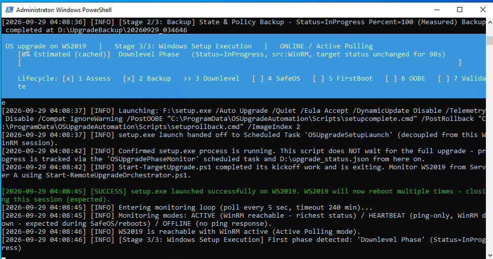

# OS Upgrade Automation

Automates and remotely monitors an **in-place Windows Server OS upgrade**
between two machines:

- **Server A (Orchestrator / management machine)** - stages the automation
  files onto Server B, kicks off the upgrade, and remotely monitors progress
  through every reboot until completion. It never performs the upgrade
  itself; it only reads status that Server B produces.
- **Server B (Target server)** - runs the pre-upgrade assessment (disk
  space, pending reboots, media compatibility, DISM/SFC health, orphaned
  profiles, admin rights, etc.), takes a recoverable backup, mounts the ISO,
  launches `setup.exe`, and tracks its own phase/percentage through
  Downlevel -> Safe OS -> First Boot -> Second Boot -> post-upgrade
  validation.

End-to-end flow: **assess -> back up -> launch Windows Setup -> survive
reboots -> monitor -> validate the final OS build.**

This repository is a hardened, production-focused rewrite of an earlier
version of the same automation. That earlier version is preserved as a
reference/baseline at
[moarshad_microsoft/osupgradetest](https://github.com/moarshad_microsoft/osupgradetest)
(commit `a458b9d`). Everything below compares this codebase against that
baseline.

## Project layout

```text
OSupgradeAutomation/
|-- ServerA-Orchestrator/
|   `-- Start-RemoteUpgradeOrchestrator.ps1   # Server A entry point
|-- ServerB-Target/
|   |-- Start-TargetUpgrade.ps1               # Assessment, backup, Setup kickoff
|   |-- Update-UpgradeStatus.ps1              # Phase/percent engine (scheduled task + hooks)
|   |-- OSUpgradeShared.ps1                   # NEW: shared helpers used by both scripts above
|   |-- Remove-UpgradeArtifacts.ps1           # Post-run cleanup
|   |-- Remove-OrphanedProfiles.ps1           # NEW: optional reviewed profile remediation
|   |-- setupcomplete.cmd / setuprollback.cmd # Windows Setup hooks (mandatory exact names)
|-- Tests/                                    # NEW: isolated PowerShell regression suite
|   |-- Orchestrator.Tests.ps1
|   |-- UpgradeStatus.Tests.ps1
|   `-- Run-SafeTests.ps1
|-- CHANGE-TRACKING.md   # Full change log, evidence and file-by-file rationale
`-- PROJECT-NOTES.md     # Running architecture/decision log
```

> Full rationale, evidence, and a line-by-line file diff summary against the
> baseline are in [CHANGE-TRACKING.md](CHANGE-TRACKING.md). This README is
> the condensed version.

## What has changed, and why

The old codebase was **functionally capable but not production-safe**: it
sometimes treated an unknown or failed condition as a success, allowed
concurrent runs to collide, and had no way to verify or test just one part
of the flow. This rewrite applies one guiding rule throughout:

> If the automation cannot prove an operation is safe or successful, it must
> stop or keep monitoring, not guess.

Key changes and the problem each one fixes:

| Area | Problem in the old code | What changed |
| --- | --- | --- |
| Startup safety | An inaccessible "existing run?" check was treated as "no existing run", risking duplicate/overlapping upgrades. | Fails closed: an unreadable state is no longer assumed to mean "safe to proceed". |
| Exit codes | A failed precheck/kickoff still returned a normal (success-looking) exit code, so schedulers/ServiceNow could report success on failure. | Exit `1` on failed kickoff/assessment/rollback; exit `0` only on real success; exit `2` on unresolved monitoring timeout. |
| Final success check | Repeated failures to query the final OS build could eventually be accepted as "upgrade succeeded". A missing `-Protocol` on the CIM session could even hang the check with an interactive prompt. | Success requires the target's own status **and** an independently queried live build number to agree; the CIM session now always explicitly authenticates and specifies `Protocol = Wsman`. |
| Status reporting | A temporary telemetry/network gap could be shown as a specific, confirmed reboot phase. | Gaps are now shown as `Unknown`/unconfirmed instead of asserting a phase that wasn't actually observed. |
| Concurrency | Nothing stopped two upgrade attempts, or an upgrade and a cleanup, from running against the same server at once. | Named mutexes on both the target starter and cleanup scripts serialize access; a duplicate kickoff is safely rejected. |
| Code duplication | `Start-TargetUpgrade.ps1` and `Update-UpgradeStatus.ps1` each had their own copy of the same status-writing logic, so the two copies could silently drift apart. | Extracted into a single shared `OSUpgradeShared.ps1`, dot-sourced by both scripts. |
| Testing/assessment modes | There was no safe way to check a server or watch progress without running (or re-running) the whole upgrade. | Added `-PrecheckOnly` (assess only, no backup/Setup) and `-MonitorOnly` (read-only resume/observe, never stages or kicks off). |
| Backup completeness | `wbadmin` (system-state backup) failures were warning-only, so Setup could still launch without real recovery evidence. Diagnostic capture (computerinfo/systeminfo/ipconfig) required by `ImprovementsRequired.md` was missing. | A full, non-skipped run now fails the backup stage if system-state backup isn't achieved; `computerinfo.txt`, `systeminfo.txt` and `ipconfig.txt` are now captured into the backup folder. |
| Setup launch confidence | Not seeing the `setup.exe` process within 60 seconds was only a warning, and kickoff was still reported as successful. | Missing process evidence now fails kickoff instead of assuming a "slow start". |
| Windows Setup EULA | Unattended Setup was not passed `/Eula Accept`, so Setup silently self-terminated during Downlevel with error `0xC190010E` (confirmed on a real Windows Server 2019 run). | `/Eula Accept` is now passed in the Setup argument list. |
| Downlevel failure detection | If `$WINDOWS.~BT` existed but no Setup process was running, the monitor always reported "Safe OS Phase" - even for a dead/failed attempt - indefinitely. | `setuperr.log` is checked first; a terminal failure signature is reported as `Status=Failed` immediately, not as an endless healthy-looking phase. |
| Cleanup safety | Cleanup could run while another operation was active, or follow a symbolic/reparse link into the wrong location. | Cleanup is now mutex-guarded and checks for reparse points and a valid cleanup path before deleting anything. |
| Remote permission checks | Access issues could surface mid-run instead of upfront. | Orchestrator explicitly verifies the remote account is a local Administrator on Server B before staging or kickoff. |
| Console/log reliability | `Write-Progress` could leave stale fragments on screen; a locked/AV-scanned log file under `Add-Content -ErrorActionPreference Stop` could silently drop lines. | Progress rendering was made stable and cleared correctly; logging was hardened against transient file locks. |
| Automated regression testing | None existed; any change could regress prior behavior without notice. | Added an isolated PowerShell test suite (`Tests/`) covering syntax validation and 150+ behavioral assertions, runnable with zero admin rights and no real target. |

## Most important improvements

1. **Fail-closed instead of fail-open.** Unknown/unreadable state, missing
   evidence, and unconfirmed success no longer default to "assume it's fine
   and continue" - the automation stops and reports uncertainty instead.
2. **Independent, authenticated final verification.** An upgrade is only
   reported as successful when the target's own recorded status **and** a
   separately queried live OS build agree - not on trust in a single source.
3. **Assessment-only and monitor-only modes** (`-PrecheckOnly`,
   `-MonitorOnly`) let you validate a server or resume watching an in-flight
   upgrade without ever risking an unintended backup or Setup launch.
4. **Concurrency protection** via named mutexes prevents overlapping
   upgrade/monitor/cleanup runs from corrupting shared state.
5. **Real recovery evidence is now mandatory** for a full production run:
   system-state backup failures block Setup launch instead of just warning,
   and host diagnostics (`computerinfo`, `systeminfo`, `ipconfig`) are always
   captured alongside the backup.
6. **Two real, previously-blocking bugs fixed from live lab runs**: Setup
   silently failing at the EULA prompt, and a failed Downlevel attempt being
   reported as a healthy "Safe OS" phase indefinitely.
7. **Shared, de-duplicated core logic** (`OSUpgradeShared.ps1`) removes the
   risk of the two target-side scripts drifting apart over time.
8. **A real automated regression suite** (`Tests/`) that runs completely
   locally (no admin rights, no real target, no OS/registry/backup changes)
   and gates changes before they ever touch a lab or production server.

## UI / monitoring display improvements

The old code rendered a single, terse progress line and could silently double
or drop console output. The Server A monitoring console now shows a clear,
structured, three-part live status instead:

```text
OS upgrade on WS2019   |   Stage 3/3: Windows Setup Execution   |   ONLINE / Active Polling
[42% Measured]  Downlevel Phase   (Status=InProgress, src:File, target status unchanged for 8s)
Lifecycle: [x] 1 Assess   [x] 2 Backup   >> 3 Downlevel   [ ] 4 SafeOS   [ ] 5 FirstBoot   [ ] 6 OOBE   [ ] 7 Validate
```

What changed and why:

1. **Explicit lifecycle checklist.** A new `[x]` / `>>` / `[ ]` strip across
   all 7 phases (Assess -> Backup -> Downlevel -> SafeOS -> FirstBoot -> OOBE
   -> Validate) makes it immediately obvious where the upgrade is and what's
   still ahead, instead of inferring it from a single percentage.
2. **Honest during connectivity gaps.** The lifecycle strip only advances from
   a confirmed numeric phase reading. During a network/telemetry gap it shows
   that it is waiting for a confirmed reading rather than silently advancing
   or freezing on a guess - consistent with the "never assert what wasn't
   observed" principle applied elsewhere in this rewrite.
3. **Clear connectivity/source labeling.** The status line now states the
   monitoring mode (`ONLINE / Active Polling` vs. `OFFLINE`/`HEARTBEAT`) and
   the channel the data came from (`src:File`, `src:WinRM`, etc.), plus how
   long the target's status has been unchanged - so a stalled upgrade and a
   healthy-but-quiet one no longer look identical.
4. **Post-upgrade validation is no longer a silent window.** Previously the
   post-upgrade validation step (activation/services comparison, which can
   take minutes) wrote nothing until it finished, so a legitimately busy
   validation looked identical to a hang. It now immediately publishes
   `Phase 7 / Post-Upgrade Validation / Status=InProgress` and states that
   Setup has already finished, so the operator isn't left guessing.
5. **Fixed duplicated/lost log lines.** The original approach to capturing the
   target's background-job output doubled every console line and silently
   dropped `WarningRecord`s. The fix reads the job's information/warning/error
   stream collections directly with a per-stream cursor and writes them
   file-only, so console rendering (via `Receive-Job`) and the log file each
   show every line exactly once, warnings included.
6. **Logs now capture everything the console shows - before, they didn't.**
   - **Before:** the target's `Write-Host`/`Write-Warning` output only ever
     reached Server A's console via `Receive-Job` - it was never written to
     the orchestrator log file, so all Stage 1/2 detail was lost the moment
     the window closed. The log also had no percentage/provenance/staleness
     trail, only phase transitions. Worse, the orchestrator log used a bare
     `Add-Content` under `$ErrorActionPreference='Stop'`, so a transient file
     lock (AV scan, full disk) could silently kill the orchestrator
     mid-upgrade.
   - **Now:** every target console line is also persisted to the log file
     (via a per-stream cursor, so each line is written exactly once - no
     duplicates, nothing dropped); a `[TRACK]` line is appended on every
     percentage/phase change and at least once a minute, recording stage,
     phase, percent, provenance, status, mode, source and how long the
     target's status has been unchanged; and all log writes go through a
     guarded `Add-LogFileLine` (`AppendAllText`) that reports a write failure
     once and keeps monitoring instead of stopping. Logs live under
     `C:\ProgramData\OSUpgradeAutomation\OrchestratorLogs` (Server A) and
     `C:\ProgramData\OSUpgradeAutomation\Logs` (Server B), so the full run
     can be reconstructed even after the console window is closed.
7. **Diagnosed and documented a false "53-minute reporting gap".** A run where
   the console appeared frozen for ~53 minutes was root-caused to Windows
   `conhost` **QuickEdit Mode** pausing the process on an accidental text
   selection/click - not an orchestrator or target defect. The fix/mitigation
   (disable QuickEdit via `HKCU:\Console`) and the diagnosis are documented so
   operators recognize the symptom instead of assuming the automation hung.

See
[CHANGE-TRACKING.md - "Logging and tracker hardening"](CHANGE-TRACKING.md#logging-and-tracker-hardening-2026-09-29)
for the full before/after measurements and rationale.

## Steps to run for test (lab / disposable VM)

Full detail, exact commands and expected output for every step are in
[CHANGE-TRACKING.md - "Exact test runbook"](CHANGE-TRACKING.md#exact-test-runbook).
Summary:

1. **Verify the Server A package** - confirm all required files (including
   the new `OSUpgradeShared.ps1` and `Tests\` scripts) are present and
   unblocked.
2. **Run the local regression suite** (no real target, no admin rights):
   ```powershell
   & powershell.exe -NoProfile -NonInteractive -ExecutionPolicy Bypass `
       -File '.\Tests\Run-SafeTests.ps1'
   ```
   Expect all syntax checks and ~150 assertions to pass. Stop here if this fails.
3. **Prepare a disposable Server B VM** - snapshot it first, place exactly
   one matching-edition upgrade ISO in `D:\ISO`, confirm free disk space and
   that WinRM is reachable.
4. **Verify Server A -> Server B connectivity** (DNS, WinRM port 5985/5986).
5. **Run assessment only** (`-PrecheckOnly`, optionally
   `-SkipDismScanHealthLab -SkipSfcScanNowLab` for a faster functional pass):
   no backup or Setup launch occurs; verify exit code `0` and
   `Status = AssessmentPassed`.
6. **Run negative/safety tests** (invalid input, non-admin account, held
   mutex) to confirm the automation rejects them safely.
7. **Run a fast smoke upgrade** on a disposable clone with
   `-SkipSystemStateBackup -SkipDismScanHealthLab -SkipSfcScanNowLab` to
   validate the end-to-end flow quickly. **This is not production
   acceptance.**
8. **Run a production-like lab upgrade** on a freshly restored snapshot with
   none of the skip flags, so DISM, SFC and the system-state backup all run
   for real.
9. **Resume monitoring** with `-MonitorOnly` if the console/Server A restarts
   mid-upgrade, instead of re-running kickoff.
10. **Inspect live target evidence** (status JSON, registry, scheduled
    tasks, logs) while the upgrade is in progress.
11. **Verify final success** - confirm `Phase = 7`, `Status` is
    `Completed`/`CompletedWithWarnings`, `PostUpgradeBuild` matches
    `TargetBuild`, and an independent `Get-CimInstance` query on Server B
    reports the same build number.
12. **Test cleanup only after reviewing evidence**, and confirm the backup
    folder (`D:\UpgradeBackup`) is preserved while registry/JSON/scheduled
    tasks are removed.

## Steps to run in production

1. Complete **all** test-runbook steps above on disposable, recoverable lab
   VMs using the real supported source OS, actual installation media and the
   real deployment credentials/authentication mode you intend to use in
   production (see
   [CHANGE-TRACKING.md - "Production acceptance still required"](CHANGE-TRACKING.md#production-acceptance-still-required)).
   Passing the local regression suite alone is **not** production
   certification.
2. Deploy the required files to Server A in the exact layout documented in
   [CHANGE-TRACKING.md - "Exact file placement"](CHANGE-TRACKING.md#exact-file-placement):
   `ServerA-Orchestrator\`, `ServerB-Target\` (including the now-mandatory
   `OSUpgradeShared.ps1`), and `Tests\` as siblings. Do **not** deploy the
   older 5-file package without `OSUpgradeShared.ps1` - the run stops before
   touching the target if it's missing.
3. On Server B, prepare `D:\ISO` (exactly one matching, newer, correct-edition
   ISO) and `D:\UpgradeBackup`. Do not pre-copy the automation scripts onto
   Server B - Server A stages them automatically.
4. Confirm a maintenance/recovery window and an approved rollback plan are in
   place, and that the account used has local Administrator rights on the
   target (verified automatically before staging, but confirm in advance).
5. Run the orchestrator **without any lab-only skip switches**
   (`-SkipSystemStateBackup`, `-SkipDismScanHealthLab`,
   `-SkipSfcScanNowLab`, `-SkipPatchCheckLab` must not be used in
   production):
   ```powershell
   & powershell.exe -NoProfile -NonInteractive -ExecutionPolicy Bypass `
       -File '.\ServerA-Orchestrator\Start-RemoteUpgradeOrchestrator.ps1' `
       -TargetComputer 'ProdServer.contoso.com' `
       -IsoFolder 'D:\ISO' `
       -BackupRoot 'D:\UpgradeBackup' `
       -StatusJsonPath 'D:\upgrade_status.json' `
       -TimeoutMinutes 240
   ```
   Use `-UseSSL` for a validated HTTPS-only WinRM listener; never use
   `-SkipCertificateCheck` in production.
6. Treat the process exit code as authoritative: `0` = completed/validated
   (or `-PrecheckOnly` passed), `1` = assessment/kickoff/rollback failure,
   `2` = monitoring ended without independently confirmed success before
   timeout (the upgrade may still be running - resume with `-MonitorOnly`,
   do not blindly re-run kickoff).
7. After a reported success, independently confirm the live OS build on the
   target and verify the system-state backup evidence under
   `D:\UpgradeBackup\<timestamp>` before considering the change closed.
8. Only run cleanup (`Remove-UpgradeArtifacts.ps1`) after reviewing that
   evidence; it removes tracking state (registry key, status JSON,
   scheduled tasks) but intentionally never deletes `D:\UpgradeBackup`.

## Further reading

- [CHANGE-TRACKING.md](CHANGE-TRACKING.md) - full change log with baseline
  comparison, every fix and its reason, the complete test runbook,
  verification evidence, exit-code contract and production-acceptance
  checklist.
- [PROJECT-NOTES.md](PROJECT-NOTES.md) - architecture notes and running
  session/decision history.
- [ImprovementsRequired.md](ImprovementsRequired.md) - the original customer
  requirements this iteration addresses (system-state backup, host
  diagnostics capture, remote-admin verification).
